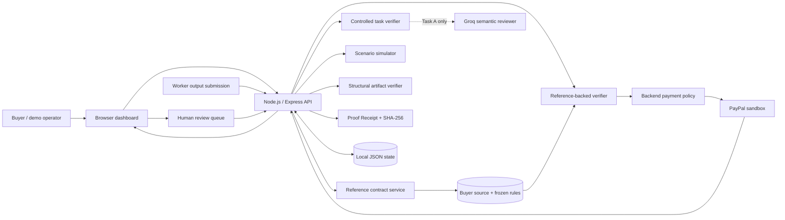

# Architecture

## Component diagram



## Reference-backed data workflow

The reference-backed flow is the strongest current evidence-verification example. It is deliberately narrow: data reconciliation with a buyer-provided source and deterministic numeric formulas.

1. **Authorize:** the buyer creates and authorizes a PayPal sandbox order. The contract route requires an active, non-voided local authorization.
2. **Freeze and reserve:** the buyer submits a source JSON/CSV file, task amount, unique key field, preserved fields, and one or more deterministic arithmetic formulas. The backend validates the source rows, unique keys, required fields, numeric formula inputs, and formula domains before storing the contract. It reserves the task amount against the authorization after accounting for completed captures, unresolved captures, and other open or pending-PASS contracts. A request that would exceed the authorization budget is rejected.
3. **Persist the source:** the local authorization record stores normalized source rows, source metadata/digest, amount, contract criteria, and contract status. The API response returns metadata and criteria, not the stored source rows.
4. **Submit output:** the worker submits a separate JSON/CSV output. The route loads the source rows and criteria from the stored contract. It does not accept replacement source data or contract criteria from the worker request.
5. **Verify:** the reference verifier checks source and output key uniqueness, record count, exact key coverage, preserved source values, and derived numeric values computed from buyer-source fields. Parse errors return REVIEW; failed comparisons return FAIL.
6. **Record once:** a contract accepts one worker submission. The resulting task and checks are persisted and included in a Proof Receipt. A revised attempt needs a newly approved contract. FAIL and REVIEW release the reservation. A PASS keeps it reserved until its capture attempt begins. An unused OPEN contract can be cancelled to release its reservation.
7. **Capture separately:** submission never calls PayPal. A recorded PASS is eligible for the existing capture endpoint. The operator explicitly requests capture; backend checks authorization status, amount budget including all other contract reservations, unresolved attempts, duplicate task attempts, and void state before calling PayPal. Starting the capture transfers that task's reservation into the capture-attempt accounting.

The verifier assumes the buyer-provided source and contract are trustworthy. It does not authenticate their issuer or validate claims outside the selected fields and formula rules.

## Controlled payment demo

1. The backend creates a USD 50 order with intent `AUTHORIZE`; checkout return is not treated as approval.
2. A sandbox Personal buyer approves the order.
3. The operator explicitly authorizes the order; the authorization ID is stored locally.
4. The controlled three-task fixture is evaluated. Task A checks required report fields and optionally receives Groq semantic review. Task B checks three seeded boolean values. Task C checks for a non-empty conclusion.
5. Only a final PASS can reach the partial capture route. Captures use `final_capture: false` and stable `PayPal-Request-Id` values. FAIL and REVIEW do not trigger capture.
6. The operator refreshes status and can void only the unused authorization remainder after all capture attempts resolve.

The controlled task fixtures demonstrate payment orchestration and recovery, not independent proof of actual business work.

## Other product flows

- **Structural artifact verifier:** accepts bounded JSON/CSV output and checks configured required fields, uniqueness, numeric values, and row count. This is useful for structural validation but does not establish domain correctness.
- **Groq reviewer:** advisory semantic check for Task A only. The model has no PayPal tools; its structured response is revalidated by the backend.
- **Human review:** recorded REVIEW tasks can be approved or rejected with notes. Approval re-runs the relevant deterministic gate and checks current PayPal status, budget, and unresolved captures. Reviewer identity is not authenticated.
- **Scenario simulator:** uses synthetic PASS/REVIEW/FAIL fixtures, marks receipts SIMULATION_ONLY, and never calls PayPal payment endpoints.
- **Proof Receipt:** records evidence, acceptance criteria, verifier provenance/checks, review outcome, payment status, and events. SHA-256 hashes detect changes to recorded snapshots; they do not prove truth or authenticated provenance.

## Trust boundaries

| Component | Trust and responsibility |
|---|---|
| Browser | Untrusted UI. It can request actions but cannot contain PayPal/Groq secrets or decide whether a capture is allowed. |
| Buyer source | Trusted only as an input supplied by the local buyer/operator; the prototype does not authenticate the buyer or verify the external source system. |
| Frozen reference contract | Stored by the backend before output submission. The worker submission route cannot replace the criteria or source rows. |
| Worker output | Untrusted. The backend parses it and checks it against the stored buyer source and frozen contract. |
| Reference verifier | Recomputes key coverage, preserved fields, and configured formulas. It proves only those contracted comparisons. |
| Structural artifact verifier | Checks structure and configured fields, not factual correctness. |
| Groq | Advisory semantic assessment of Task A only. Output is structured and revalidated; it has no payment tools. |
| Express backend | Holds credentials and enforces state checks, amount limits, idempotency, and PASS-only capture gates. |
| PayPal sandbox | Authoritative external state for order, authorization, capture, and void status. |
| JSON state | Local state and audit aid for this single-process demo. It is not a transactional production datastore. |
| Proof Receipt | Hashed snapshot of evidence and decisions; hashes detect changes but do not establish truth or authenticated issuer identity. |
| Scenario simulator | Uses synthetic examples and never calls PayPal; output is hypothetical, not a live verification result. |

## Payment decision policy

```text
Buyer source + buyer-approved contract
                 |
                 v
       Freeze in local state
                 |
Worker output ---+
                 |
                 v
      Reference-backed verifier
          | PASS       | FAIL
          |             +------> Record; no capture
          | REVIEW/parse error
          +--------------------> Record; human review; no capture
                 |
                 v
        Explicit capture request
                 |
                 v
   Backend authorization/budget/duplicate/
   unresolved-capture/void-state checks
                 |
                 v
        PayPal sandbox partial capture
                 |
                 v
        Proof Receipt + audit events
```

An eligible PASS is not itself proof of payment success. The PayPal response and later provider status determine capture state.

## State and failure handling

- State-changing routes run through a single-process mutation queue.
- Capture attempts are persisted before the outbound capture request.
- Amounts in `IN_PROGRESS`, `UNKNOWN`, or `PENDING` status remain reserved when calculating available funds.
- OPEN reference contracts reserve their full agreed amount. Submitted PASS contracts remain reserved until a capture attempt is persisted; FAIL and REVIEW release the reservation. Capture routes include these reservations in their budget checks, and the authorization cannot be voided while reservations remain. Only an unused OPEN contract can be cancelled.
- Network errors, timeouts, conflicts, throttling, and server errors are treated conservatively as uncertain.
- Reconciliation reuses the original idempotency key and request payload or queries a known capture ID. It does not automatically continue a partially completed task sequence.
- Void is refused while a capture is unresolved. A successful void releases only the unused authorization remainder, not money already captured.
- A reference contract is single-submission. Failed or REVIEW submissions are retained; a revised deliverable requires a newly approved contract.

## Review and receipt policies

- Only an unreviewed task whose original verifier decision is REVIEW can enter the human-review endpoint.
- Human approval cannot turn deterministic hard-check failures into PASS.
- Approval queries PayPal for current authorization status and is blocked for void requests, unsupported statuses, exceeded budget, or unresolved prior captures.
- The reviewer decision is persisted before attempting capture. Uncertain attempts must use reconciliation.
- Rejections never call PayPal capture endpoints.
- Reviewer names are unverified audit labels. Do not expose this API to a network.
- Startup rejects `HOST` values other than `127.0.0.1` or `::1` while API authentication is absent. This does not protect against a separately configured reverse proxy or tunnel; keep remote access disabled.
- Simulation receipts use mode SIMULATION_ONLY, payment.authoritative false, and no capture ID.
- Reference contract creation and worker submission do not call PayPal. Only the separate PASS task capture route calls the payment endpoint.

## Deliberate non-goals

This build does not provide production identity/access management, distributed locking, webhook ingestion, durable multi-instance state, authenticated buyer-source provenance, generalized arbitrary task execution, a fully autonomous worker agent, a calibrated AI decision model, or a separate contractor payout/disbursement flow.
