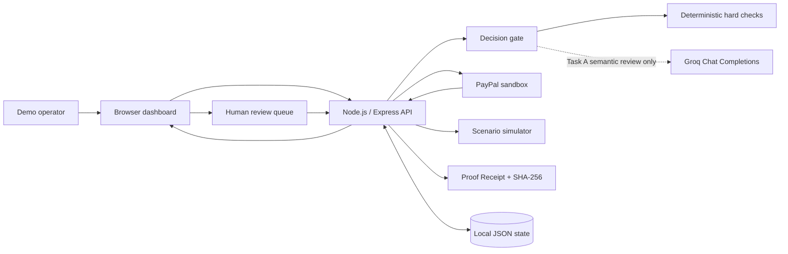

# Architecture

## Component diagram



## End-to-end flow

1. **Create order:** the backend creates one USD 50 PayPal order with intent `AUTHORIZE`. The browser opens the returned PayPal approval link.
2. **Buyer approval:** the sandbox buyer approves the order. Returning to the local site is not treated as proof of authorization.
3. **Authorize:** the operator submits the order ID to the backend, which calls the Orders API authorize endpoint and persists the authorization ID.
4. **Preview (optional):** the preview endpoint evaluates the sample tasks but does not call PayPal payment endpoints. It may call Groq if configured.
5. **Evaluate tasks:** the deterministic verifier checks required structure. Task A can then receive an advisory semantic review from Groq. Tasks B and C use explicit deterministic checks.
6. **Gate capture:** only `PASS` proceeds to a partial capture. `FAIL` and `REVIEW` have no capture attempt. Each capture uses a stable `PayPal-Request-Id` and `final_capture: false`.
7. **Reconcile:** ambiguous attempts remain reserved. The reconciliation endpoint checks a known capture ID or replays the exact capture request with its original request ID and payload.
8. **Human review:** a recorded REVIEW task can be approved or rejected with reviewer notes. Approval re-runs deterministic hard gates, checks current PayPal authorization and budget, refuses if prior captures are unresolved, then persists the reviewer event and stable capture attempt before calling PayPal. Rejection records the reviewer decision without a capture request.
9. **Proof Receipt:** the receipt API exports evidence, acceptance criteria, verifier provenance, review decision, payment status, and events. Canonicalized SHA-256 hashes make snapshot changes detectable; they do not prove evidence truth.
10. **Scenario simulator:** PASS, REVIEW, and FAIL use synthetic evidence, report zero actual capture, and never call PayPal payment endpoints.
11. **Verify and close:** refresh authorization from PayPal. After all capture attempts are resolved, the operator can explicitly request a void of the unused authorization remainder.

## Trust boundaries

| Component | Trust and responsibility |
|---|---|
| Browser | Untrusted UI. It can request actions but does not contain PayPal or Groq secrets and does not decide whether to capture. Reviewer identity is not authenticated by this prototype. |
| Express backend | Holds credentials and enforces state checks, amount limits, idempotency, and the PASS-only capture gate. |
| Deterministic verifier | Validates explicit structural/business rules. It does not prove natural-language claims are factually true. |
| Groq | Advisory semantic assessment of Task A evidence. Output is structured and revalidated; it has no payment tools. |
| PayPal sandbox | Authoritative external state for order, authorization, capture, and void status. |
| JSON state | Local audit aid for this single-process demo. It is not a transactional production datastore. |
| Proof Receipt | Hashed snapshot of evidence and decisions; hashes detect snapshot changes but do not establish truth or authenticated provenance. |
| Scenario simulator | Uses synthetic examples and never calls PayPal; output is hypothetical, not a live verification result. |

## Decision policy

```text
Task evidence
    |
    v
Deterministic hard gate
    | FAIL ----------------------> No capture
    | PASS
    v
Task A + GROQ_API_KEY?
    | Yes -> Groq decision
    |          PASS -> Eligible for capture
    |          FAIL -> No capture
    |          REVIEW / error / invalid -> No capture
    |
    | No or Task B/C -> deterministic result
    v
Capture only when final decision is PASS, or an explicit REVIEW approval passes all backend hard gates
    |
    v
Record provider status; reconcile anything ambiguous
```

Eligibility is not itself proof that a capture succeeded. Capture status is recorded from the PayPal response and verified separately.

## State and failure handling

- State-changing routes run through a single-process mutation queue.
- Capture attempts are persisted before the outbound capture request.
- Amounts in `IN_PROGRESS`, `UNKNOWN`, or `PENDING` status remain reserved when calculating available funds.
- Network errors, timeouts, conflicts, throttling, and server errors are treated conservatively as uncertain.
- Reconciliation reuses the original idempotency key and request payload or queries a known capture ID. It does not automatically continue a partially completed task sequence.
- Void is refused while a capture is unresolved. A successful void releases only the unused authorization remainder, not money already captured.

## Review and receipt policies

- Only an unreviewed task whose original verifier decision is REVIEW can enter the human-review endpoint.
- Human approval cannot turn a deterministic required-field failure into PASS; the deterministic gate must pass again.
- Approval queries PayPal for current authorization status and is blocked for a void request, unsupported status, exceeded budget, or any unresolved prior capture.
- The reviewer decision is persisted before attempting capture. A reviewed task cannot be submitted a second time; uncertain attempts must use reconciliation.
- Rejections never call PayPal capture endpoints.
- Review is unauthenticated in this local demo. Reviewer names are unverified audit labels; do not expose this API to a network.
- Simulation receipts use mode SIMULATION_ONLY, payment.authoritative false, and no capture ID.

## Deliberate non-goals

This build does not provide production identity and access management, distributed locking, webhook ingestion, durable multi-instance state, an independently validated truth oracle, generalized arbitrary task execution, or a calibrated AI decision model.
